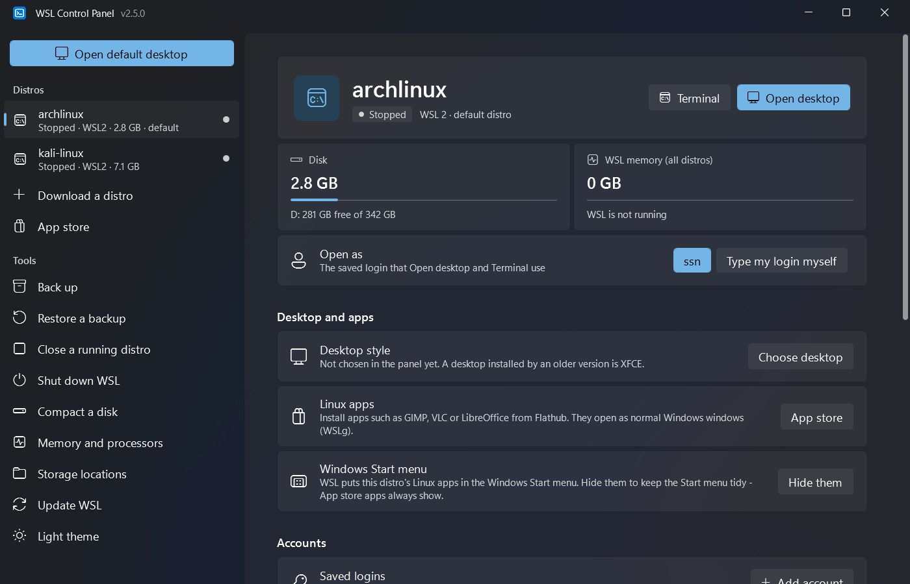
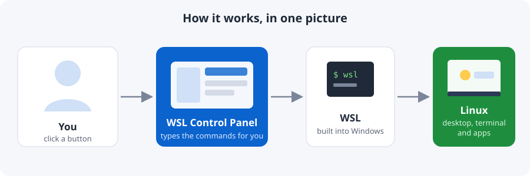
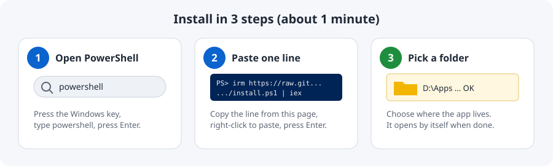
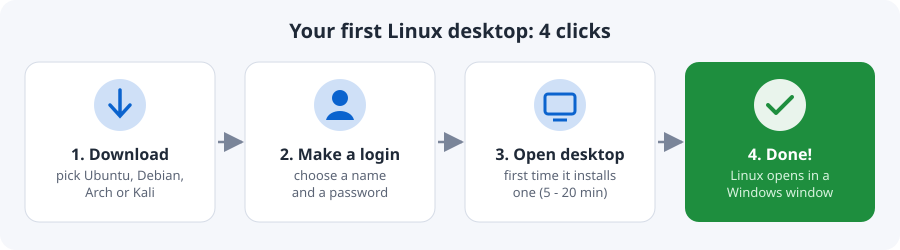
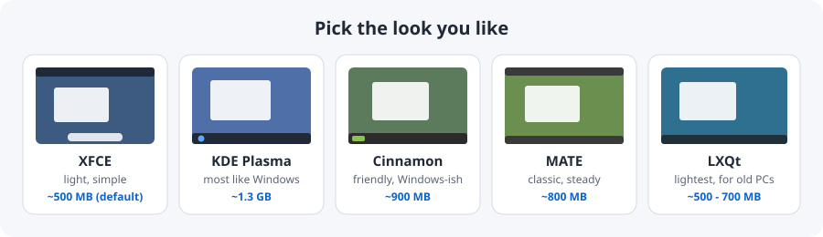
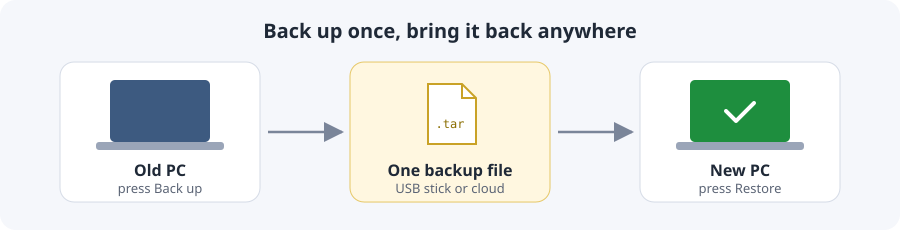

# WSL Control Panel

**Run Linux on your Windows PC with buttons, not commands.**

WSL Control Panel is a free Windows app for people who want to try Linux
without learning the terminal first. Install a Linux system, open its desktop
in a window, add apps, and back everything up, all by clicking.



<sub>The main window: your Linux systems on the left, what you can do with the
picked one on the right. It follows Windows' dark or light theme.</sub>

---

## What is this, in plain words?

Windows has a built-in feature called **WSL** (Windows Subsystem for Linux).
It lets a real Linux system run inside Windows, side by side with your normal
apps. No second PC, no restart into another system.

The catch: WSL is normally used by typing commands. **This app types them for
you.**



A "**distro**" is just one Linux system (for example Ubuntu, Debian, Arch or
Kali). You can have several at once, each in its own folder.

---

## What you can do with it

| | |
|---|---|
| 🐧 **Get Linux** | Download Ubuntu, Debian, Arch, Kali and more from Microsoft's official list. |
| 🖥️ **Open a Linux desktop** | A full Linux desktop opens in a normal Windows window. |
| ⌨️ **Open a terminal** | For when you *do* want to type commands. |
| 🛍️ **App store** | Install Linux apps (GIMP, VLC, LibreOffice...) in one click. They open like Windows apps. |
| 💾 **Back up and restore** | Save a whole Linux system into one file. Bring it back later, or on a new PC. |
| 📄 **Clone** | Make a full copy before you try something risky. |
| 🔑 **Saved logins** | It remembers your Linux password (safely encrypted) and logs you in. |
| 🧹 **Free up space and memory** | Shrink Linux disks, close systems you are not using, limit how much memory Linux may use. |

---

## Install (about 1 minute)



1. Press the **Windows key**, type `powershell`, and press **Enter**.
   A blue window opens.

2. Copy this line, **right-click** inside the blue window to paste it, and
   press **Enter**:

   ```powershell
   irm https://raw.githubusercontent.com/ssn-26/wsl-setup-and-run-helper/main/install.ps1 | iex
   ```

3. A folder window opens: **pick where the app should live** (for example
   `D:\Apps`) and click **OK**.

That's it. WSL Control Panel opens by itself. Next time, find it in the
**Start menu**.

- ✅ No administrator rights needed for the app itself.
- ✅ Works on **Windows 10** (version 2004 or newer) and **Windows 11**.
- ✅ To **update** later: the app shows **Update now** when a new version is
  out. One click; your Linux systems and logins stay.
- ✅ To **uninstall**: Windows **Settings > Apps > WSL Control Panel**. Your
  Linux systems and backups are never deleted by this.

> **Brand-new PC without WSL?** The first time you open the app, it offers to
> turn WSL on for you. Windows asks for permission once (a "Do you want to
> allow this app to make changes" box), and you may need to **restart** your
> PC. After the restart, open the app again.

---

## Your first Linux desktop



1. Click **Download a distro** on the left. Pick one (not sure? pick
   **Ubuntu**). Choose a folder with a few GB of free space.
2. When it finishes, the app asks you to **make a login**: a user name and a
   password for your new Linux. Write the password down.
3. Click **Open desktop**. The first time, the app says there is no desktop
   yet: click **Install the desktop now** and wait 5 - 20 minutes (it downloads
   it).
4. A window opens with your Linux desktop, already logged in. 🎉

**Tip:** once it is set up the way you like, click **Back up** so you never
have to do it again.

---

## Choose how your desktop looks

Click **Choose desktop** on a distro's page. Each style shows a small preview,
how much it looks like Windows or macOS, and how big it is.



Not sure? Keep **XFCE**: it is small, fast and simple. You can switch later;
switching to one you already installed takes seconds.

---

## Moving to a new PC



1. On the old PC: click **Back up**, pick the distro and a folder. You get one
   file with *everything* inside: apps, settings, files.
2. Copy that file to a USB stick or cloud storage.
3. On the new PC: install WSL Control Panel, click **Restore a backup**, and
   pick the file. Your Linux comes back exactly as it was.

(Saved passwords are locked to your old Windows account, so add your login
again with **Add account**, and switch *"Also create this user"* **off**.)

---

## Is it safe?

- 🔒 **Passwords are encrypted** by Windows itself, so only *your* Windows
  account on *your* PC can read them. They are never saved as plain text.
- 🗂️ **Your Linux systems and backups go only where you choose.** Updating or
  uninstalling the app never touches them.
- ⚠️ **Nothing gets deleted by accident.** To delete a distro you must type its
  name, and Restore never overwrites an existing one.
- 👀 **No secrets.** Every window tells you what it is about to do and which
  `wsl` command it runs, so you learn as you go. All the code is right here
  in this repository to read.

---

## Something went wrong?

| What you see | What to do |
|---|---|
| A download stops with *"connection was reset"* | Click **Try the resumable download**. It carries on where it stopped. |
| *"...is running its own desktop on port 3390"* | Click **Give it a different port**, so both desktops can stay open. |
| The Linux desktop is black | Log out from inside the desktop (its menu), then click **Open desktop** again. |
| After **Choose desktop** you still see the old one | Same: log out inside the desktop, then **Open desktop** again. |
| The desktop closes a few seconds after opening | Always open it from the app (it keeps Linux awake). |
| An App store app doesn't open | Click **Update WSL**, then **Shut down WSL**, and try again. |
| *"ERROR_SHARING_VIOLATION"* | Click **Shut down WSL and try again**. Still stuck? Restart Windows. |
| WSL itself won't start | Click **Update WSL**, then restart Windows. |

More problems and their fixes are in the technical section below.

---

## Which Linux works?

| Linux | Desktop | Tested |
|---|---|---|
| Ubuntu 24.04 | Remote Desktop (any style) | ✅ |
| Debian | Remote Desktop (any style) | ✅ |
| Arch Linux | Remote Desktop (any style) | ✅ |
| Kali Linux | Kali's own desktop (Win-KeX) | ✅ |
| Other Ubuntu versions, Fedora, openSUSE | Remote Desktop | ⚠️ should work, not fully tested yet |
| AlmaLinux, Oracle Linux, SUSE Enterprise | none | Terminal only |

Terminal, back up, restore, close and delete work with **every** distro.

---

## For the technical folks

<details>
<summary><b>What each button does behind the scenes</b></summary>

| Button | What runs |
|---|---|
| Open desktop | Wakes the distro and opens its desktop (Remote Desktop via xrdp, or Win-KeX on Kali), logged in with the chosen saved account |
| Terminal | A terminal window (Windows Terminal when installed) as the chosen account |
| Close / Close running | `wsl --terminate`, which frees that distro's RAM |
| Shut down WSL | `wsl --shutdown`, which frees the whole WSL VM |
| Download a distro | `wsl --install` from Microsoft's official list, with a resumable fallback that checks the SHA-256 |
| Back up | `wsl --export` to one `.tar` (or faster `.vhdx`) file |
| Restore | `wsl --import` |
| Clone | `wsl --export --vhd` into the new folder, then `wsl --import-in-place` |
| Choose desktop | Installs XFCE, KDE Plasma, Cinnamon, MATE or LXQt + xrdp (apt / dnf / zypper / yum / pacman; xrdp from the AUR on Arch) |
| App store | `flatpak install` from [Flathub](https://flathub.org); apps open through WSLg |
| Compact a disk | Hands unused `ext4.vhdx` space back to Windows (admin, diskpart) |
| Memory and processors | Sets `memory`, `processors` and `swap` in `.wslconfig` (backup kept as `.wslconfig.bak`) |
| Storage locations | Shows where every distro, backup and the app's settings are |
| Update WSL | `wsl --update` (admin) |

Keyboard: **Esc** closes a dialog, **Enter** presses its main button, **F5**
refreshes, **Ctrl+1** to **Ctrl+9** pick a distro.

Other details:

- xrdp uses port **3390** by default (Windows' own Remote Desktop uses 3389).
  Each distro can have its own port, so two desktops can be open at once.
- On Debian/Ubuntu desktops are installed without optional extras, so XFCE or
  LXQt is about 500 MB. The clock is set to your Windows time zone.
- After a desktop install, its Linux apps are kept out of the Windows Start
  menu (the **Windows Start menu** row on the distro page shows them again).
  App store apps always show.
- Docker Desktop and Rancher Desktop distros are hidden, but the app never
  shuts WSL down under them.
- A keep-alive holds the distro up while its desktop is open.
</details>

<details>
<summary><b>Other ways to install</b></summary>

- **From a downloaded copy of the code:** click **Code > Download ZIP** on
  this page, unzip it, and double-click `Install.bat`. (Windows may ask "Do you
  want to run this file?" because the ZIP came from the internet; the
  PowerShell line above avoids that.)
- Run the PowerShell line again at any time to update; it keeps the folder you
  chose.
- The installer builds the small `WSL Control Panel.exe` on your PC with the
  C# compiler that is part of Windows. The exe only starts the app's
  PowerShell scripts, so there is no console window behind the app.
- If it says *"Building WSL Control Panel.exe failed"*, your antivirus probably
  blocked the C# compiler: allow it and run the line again.
</details>

<details>
<summary><b>More troubleshooting</b></summary>

| Problem | Why | What to do |
|---|---|---|
| *"The Kali desktop (Win-KeX) cannot run as root"* | A fresh Kali has no normal user yet | Choose **Create my user** |
| Kali: TigerVNC *"Failed to connect to localhost:1 ... (10061)"* | Win-KeX was installed without Kali's XFCE desktop | The app offers **Install the desktop now** (adds `kali-desktop-xfce`) |
| `AUR_BUILD_FAILED` (Arch) | Building xrdp from the AUR failed | Read the install log the app names (in `data\logs`). Usually no internet or a full disk |
| Remote Desktop is black and XFCE's panel appears on the Windows desktop | WSLg was picked over xrdp's screen | Fixed in current versions. For an older desktop: re-add the account with **Add an account** (creating the user), log out, open the desktop again |
| Remote Desktop is black, nothing on Windows either | The session didn't start for that user | Log in with a user the app created. Or check that `~/.xsession` ends with `exec "$SESSION"` and `/etc/wsl-panel-session` names the desktop's start command |
| *"ERROR_SHARING_VIOLATION"* | Another program has the distro's disk open (stuck WSL, a copy running, antivirus, a double-clicked `.vhdx`) | The app offers **Shut down WSL and try again** or **Detach the disk and try again** |
| App store app not in the Start menu | WSLg missing or Start menu not refreshed yet | **Update WSL**, **Shut down WSL**, try again. **Open** in the App store always works |
</details>

<details>
<summary><b>How it is built</b></summary>

- `WSL Control Panel.exe` (from `build\Launcher.cs`) runs PowerShell inside
  itself. `app\windows\Engine.ps1` does all the work and never asks anything;
  the WPF window (`app\windows\WSL-Control-Panel.ps1` + `ui\MainWindow.xaml`)
  decides what to ask next. Long jobs run in a background runspace that
  streams output back, so the window never freezes.
- The Linux-side scripts are readable files in `app\linux\`
  (`install-desktop.sh`, `create-user.sh`, `keepalive.sh`, `flatpak.sh`,
  `startmenu.sh`, `set-timezone.sh`, `xsession`). They are sent into the
  distro as base64, so no layer of quoting can mangle them.
- Arguments are passed one by one, never as one long command string; Linux
  usernames are validated (`^[a-z_][a-z0-9_-]*$`).
- Distros are read from the registry plus `wsl --list --running --quiet`, so
  it works on any Windows language. Kali is detected from `/etc/os-release`.
- Passwords are DPAPI-encrypted and go to `chpasswd` over stdin, never on a
  command line or disk.
- Desktop sessions force X11 (`GDK_BACKEND=x11`, no `WAYLAND_DISPLAY`) so they
  draw inside Remote Desktop, and point sound at WSLg's PulseAudio server.
- Admin steps (first-time setup, compact) are passed straight to the elevated
  window, never through a script file in `%TEMP%`.
- Keep `.ps1` files plain ASCII, `app\linux\` LF, and `Install.bat` CRLF.
  Check scripts parse with Windows PowerShell 5.1, not PowerShell 7.
- Every push runs `.github/workflows/checks.yml`: PowerShell 5.1 parse, ASCII,
  CRLF, building the window (`-Validate`), `shellcheck`, PSScriptAnalyzer.

Folder layout:

```
app\
  windows\     the app: WSL-Control-Panel.ps1, Engine.ps1, AppIcon.ps1, ui\MainWindow.xaml
  linux\       scripts that run inside Linux
build\         Launcher.cs + build-launcher.ps1 (the exe), setup.iss + build-setup.ps1
docs\images\   pictures for this README
Install.bat    double-click installer for a downloaded copy
install.ps1    installs, updates and uninstalls
CHANGELOG.md   what changed in each version
data\          (on your PC only, never committed) settings, saved logins, logs
```

Your Linux disks and backups are never stored in the app's folder: Download,
Back up and Restore always ask where.
</details>

<details>
<summary><b>Making a release</b></summary>

1. Raise `$PANEL_VERSION` in `app\windows\WSL-Control-Panel.ps1` (and the
   two `vX.Y.Z` texts in `ui\MainWindow.xaml`).
2. Add a `## X.Y.Z` section to `CHANGELOG.md` (it becomes the release notes).
3. Merge to `main`, then `git tag vX.Y.Z` and `git push origin vX.Y.Z`.

GitHub checks the version, runs the self-test and publishes the release.
Installed copies then offer **Update now** (this needs the repository to be
public).
</details>

---

## About

Made by [ssn-26](https://github.com/ssn-26) while learning bash and Windows
scripting through a real, working project.

## Licence

MIT. See [LICENSE](LICENSE). You may use, change and share it, including
commercially, as long as the copyright notice stays. No warranty.
